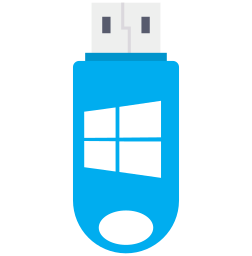

<p align="center">
  
</p>

<h1 align="center">deepines-win-usb-installer</h1>

<p align="center">
  Un proyecto de la comunidad <a href="https://deepinenespañol.org">Deepin en Español</a>
</p>

Creador de memorias USB de instalación de Windows 10/11 para equipos **UEFI**
(compatible con Secure Boot), escrito en C++ con **Qt6** y **DTK6**.

## Cómo funciona

1. Seleccione (o arrastre a la ventana) el archivo `.iso` oficial de Windows.
2. Seleccione la unidad USB (la lista se actualiza sola al conectar/desconectar).
3. Confirme el borrado y autentíquese (polkit/pkexec).

La unidad queda con una tabla GPT y dos particiones:

| Partición    | Formato | Contenido                                        |
|--------------|---------|--------------------------------------------------|
| `EFI`        | FAT32   | Archivos de arranque + `sources/boot.wim`        |
| `INSTAL-WIN` | exFAT   | Contenido completo de la ISO (install.wim > 4 GiB) |

La interfaz se ejecuta sin privilegios. Las operaciones de disco las realiza el
mismo ejecutable en modo `--helper`, lanzado con `pkexec`, que valida que el
destino sea un disco USB y que la ISO sea un instalador de Windows **antes** de
borrar nada.

## Estructura

```
src/
  main.cpp            Punto de entrada (interfaz o modo --helper)
  core/               Constantes y detección de unidades USB (lsblk)
  helper/             Modo privilegiado: particionado, formateo y copia
  gui/                Ventana principal DTK
  translations/       Traducciones (.ts) al inglés y al español
data/
  applications/       Lanzador .desktop
  icons/              Icono de la aplicación
  images/             Logo de Deepin en Español (diálogo «Acerca de»)
  polkit/             Política de pkexec
  resources.qrc       Recursos embebidos
debian/               Empaquetado .deb
```

## Compilar

Dependencias (Deepin 23/25):

```sh
sudo apt install cmake g++ qt6-base-dev libdtk6core-dev libdtk6gui-dev libdtk6widget-dev \
    qt6-l10n-tools qt6-tools-dev-tools
```

```sh
cmake -S . -B build -DCMAKE_BUILD_TYPE=Release
cmake --build build -j
sudo cmake --install build
```

Paquete `.deb`:

```sh
dpkg-buildpackage -us -uc -b
```

Dependencias en tiempo de ejecución: `util-linux` (sfdisk, wipefs, lsblk,
mount), `dosfstools`, `exfatprogs`, `pkexec`, `udev`.

## Traducciones

Los textos originales del código están en español. Las traducciones están en
`src/translations/` y se compilan dentro del ejecutable; si no existe traducción
para el idioma del sistema, la aplicación se muestra en inglés.

Para actualizar los `.ts` después de cambiar textos:

```sh
/usr/lib/qt6/bin/lupdate -no-obsolete -locations none src -ts src/translations/*.ts
```

## Proyecto original

Basado en [deepines-win-usb-installer](https://github.com/igatjens/deepines-win-usb-installer),
creado por [Isaías Gätjens M](https://github.com/igatjens).
